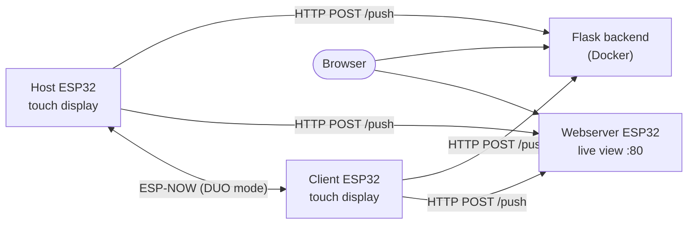

# 🎮 DigiBoard

**Tic-Tac-Toe on ESP32 touch displays: alone, against an AI, or two boards against each other over ESP-NOW, with a live view in the browser and saved game history.**

## What it does

- **Touchscreen game** on an ILI9341 display with an XPT2046 touch controller, driven by an ESP32-S3.
- **4 game modes:** local 2-player, AI *easy*, AI *hard* (unbeatable **minimax**) and **DUO**, where two separate boards play against each other wirelessly over **ESP-NOW**.
- **Live view:** each board pushes its game state to a third ESP32 running a web server, which shows the current board in the browser.
- **Game history:** a small **Flask** backend (runs in Docker) stores every game as JSON and lists it again via `/games`.
- On-device settings screen, IP entry for the backend and a "save game?" prompt after DUO matches.

## Architecture

In DUO mode only the client publishes the state, so one match is saved as exactly one game.

| Folder | Content |
|---|---|
| [`ESP-Codes/Esp-Codes/Host-ESP`](ESP-Codes/Esp-Codes/Host-ESP) | Firmware for board 1: game, AI, UI, ESP-NOW host |
| [`ESP-Codes/Esp-Codes/Client-ESP`](ESP-Codes/Esp-Codes/Client-ESP) | Firmware for board 2: ESP-NOW client, the publisher in DUO mode |
| [`ESP-Codes/Esp-Codes/Webserver-ESP`](ESP-Codes/Esp-Codes/Webserver-ESP) | Live-view web server (`/`, `/state`, `/push`) |
| [`ESP-Codes/Flask_Code.py`](ESP-Codes/Flask_Code.py) | Backend: `/push`, `/latest`, `/state`, `/games` |

## Hardware

- 3× ESP32-S3 (two boards with displays, one as the web server)
- 2× ILI9341 TFT with XPT2046 touch
- Arduino libraries: `Adafruit_GFX`, `Adafruit_ILI9341`, `XPT2046_Touchscreen`, and `WiFi`, `HTTPClient`, `esp_now` (from the ESP32 core)

## Setup

1. Set your WLAN name and password and the web server IP at the top of each `.ino` file.
2. Flash `Webserver-ESP` first, then `Host-ESP` and `Client-ESP` with the Arduino IDE and the ESP32 core.
3. Start the backend: `pip install flask && python ESP-Codes/Flask_Code.py` (port 5000)
4. Open the web server's IP in the browser to watch the games live.

---

> *"Wenn der Kühlschrank anfängt zu philosophieren, frag den Toaster ob die Zeit rückwärts läuft!"* – Albert Meilenstein
